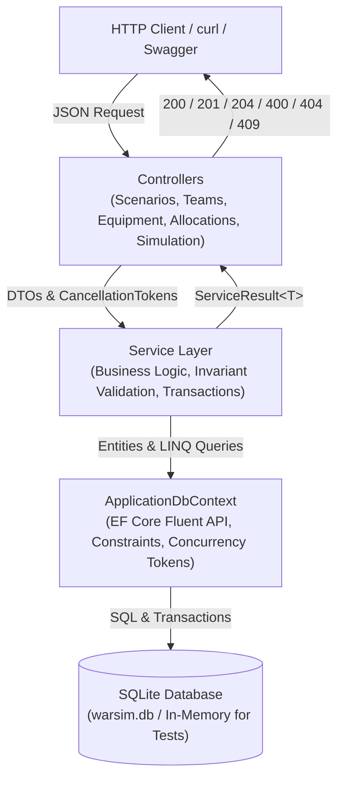
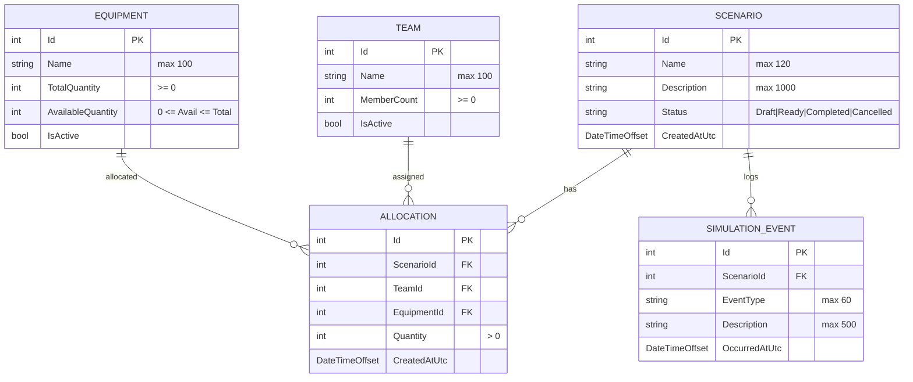

# WarSim — Training Scenario & Resource Management API


**WarSim** is a backend REST API developed in C# and ASP.NET Core for training administrators to plan fictional scenarios, manage participant teams, track generic equipment inventory, execute transactional resource allocations, and generate transparent readiness coverage audits.

> **Scope & Safety Notice:** This is an administrative portfolio project using fictional training data. It does not model tactical combat, targeting, weapons, intelligence, or operational decision-making.

---

## 1. Project Objectives

- **Relational Integrity**: Enforce strict data relationships, composite uniqueness, and check constraints using Entity Framework Core and SQLite.
- **Transactional Consistency**: Ensure that generic equipment inventory allocations and cancellations are atomic and prevent over-allocation or race conditions.
- **Clean Layered Architecture**: Decouple HTTP transport, service business logic, and data access without unnecessary abstractions.
- **Transparent Administrative Calculations**: Calculate equipment coverage percentages deterministically without arbitrary or opaque scoring rules.
- **Robust Automated Verification**: Validate observable domain invariants, concurrency control, and boundary states using xUnit integration tests.

---

## 2. Key Features

- **Scenario Management**: Full lifecycle management (`Draft`, `Ready`, `Completed`, `Cancelled`) with validation preventing mutation of locked scenarios.
- **Team Registry**: Register training squads with non-negative headcount tracking and active/inactive status switches.
- **Equipment Inventory Invariants**: Register non-weapon generic assets (radios, laptops, first aid kits). Enforces $0 \le \text{AvailableQuantity} \le \text{TotalQuantity}$.
- **Transactional Resource Allocation**:
  - Atomic inventory decrement upon allocation.
  - Automatic inventory restoration when an allocation is removed.
  - Rejection of duplicate `(ScenarioId, TeamId, EquipmentId)` records.
  - Concurrency token protection on available stock.
- **Administrative Simulation & Event Audit Log**:
  - Computes active team allocation coverage percentage.
  - Persists an immutable audit log (`SimulationEvent`) on successful runs.
  - Read-only historical query ordered newest-first.

---

## 3. Technology Stack

- **Framework**: .NET 10 (`net10.0`) / ASP.NET Core Web API
- **Language**: C# 14 with Nullable Reference Types enabled
- **Database**: SQLite with Foreign Key constraints enabled
- **ORM**: Entity Framework Core 10.0 (Relational & SQLite providers)
- **API Documentation**: Built-in ASP.NET Core OpenAPI (`Microsoft.AspNetCore.OpenApi`) with full endpoint summaries and RFC 7807 ProblemDetails
- **Testing**: xUnit with SQLite In-Memory relational test harness

---

## 4. Architecture Overview

WarSim adheres to a clean layered design:

```
HTTP Request → Controller → Service Layer → DbContext → SQLite Database → HTTP Response
```



- **Controllers**: Thin HTTP boundary. Handles parameter binding, invokes services, and maps `ServiceResult<T>` to status codes (`200 OK`, `201 Created`, `204 NoContent`, `400 BadRequest`, `404 NotFound`, `409 Conflict`).
- **DTOs**: Completely decouples internal EF Core entities from external API contracts. Applies Data Annotations for length, ranges, and required fields.
- **Services**: Encapsulates all domain validations, transaction boundaries (`BeginTransactionAsync`), and business calculations.
- **Data**: Centralized EF Core `ApplicationDbContext` with database-level check constraints and explicit `DeleteBehavior.Restrict` policies.

---

## 5. Database Entities & Relationships



- **Composite Uniqueness**: `Allocation` enforces a unique index on `(ScenarioId, TeamId, EquipmentId)`.
- **Referential Integrity**: Scenarios, Teams, and Equipment cannot be accidentally deleted while referenced by active allocations (`DeleteBehavior.Restrict`).

---

## 6. API Endpoint Summary

| HTTP Method | Route | Description | Success Code | Error Codes |
|---|---|---|---|---|
| `POST` | `/api/scenarios` | Create a training scenario | `201 Created` | `400` |
| `GET` | `/api/scenarios` | List all scenarios | `200 OK` | — |
| `GET` | `/api/scenarios/{id}` | Get scenario details by ID | `200 OK` | `404` |
| `PUT` | `/api/scenarios/{id}` | Update draft scenario | `200 OK` | `400`, `404` |
| `DELETE` | `/api/scenarios/{id}` | Delete scenario (if dependency-free) | `204 NoContent` | `400`, `404` |
| `POST` | `/api/teams` | Register a new training squad | `201 Created` | `400` |
| `GET` | `/api/teams` | List all registered squads | `200 OK` | — |
| `GET` | `/api/teams/{id}` | Get squad details by ID | `200 OK` | `404` |
| `POST` | `/api/equipment` | Register generic equipment item | `201 Created` | `400` |
| `GET` | `/api/equipment` | List all equipment & stock | `200 OK` | — |
| `GET` | `/api/equipment/{id}` | Get equipment item by ID | `200 OK` | `404` |
| `POST` | `/api/scenarios/{scenarioId}/allocations` | Allocate stock to team in scenario | `201 Created` | `400`, `404`, `409` |
| `GET` | `/api/scenarios/{scenarioId}/allocations` | List allocations for scenario | `200 OK` | `404` |
| `DELETE` | `/api/allocations/{allocationId}` | Remove allocation & restore stock | `204 NoContent` | `400`, `404`, `409` |
| `POST` | `/api/scenarios/{scenarioId}/run` | Run administrative coverage simulation | `200 OK` | `400`, `404` |
| `GET` | `/api/scenarios/{scenarioId}/events` | Get scenario audit event history | `200 OK` | `404` |

---

## 7. Prerequisites

- [.NET 10.0 SDK](https://dotnet.microsoft.com/download) (or .NET 9.0 LTS if targeting an alternative supported runtime)
- SQLite3 CLI (optional, for inspecting `warsim.db` directly)
- `curl` or HTTP client for exercising endpoints

Verify your installation:
```bash
dotnet --version
```

---

## 8. Installation & Database Setup

1. **Clone the repository**:
   ```bash
   git clone <repo-url>
   cd WarSim
   ```

2. **Restore dependencies**:
   ```bash
   dotnet restore
   ```

3. **Apply EF Core Migrations**:
   The solution includes migrations in `WarSim/Migrations/`. Run:
   ```bash
   dotnet ef database update --project WarSim --startup-project WarSim
   ```
   *(If `dotnet-ef` is not installed globally: `dotnet tool install --global dotnet-ef`)*

---

## 9. Running the Application

Start the Kestrel server:
```bash
dotnet run --project WarSim --urls "http://localhost:5270"
```

Access the OpenAPI document:
- OpenAPI JSON specification: `http://localhost:5270/openapi/v1.json`

---

## 10. Running Automated Tests

Run the complete xUnit test suite (90 automated unit and integration tests):
```bash
dotnet test
```

Tests run in-memory using SQLite with foreign keys enforced:
- **Smoke Tests**: Verifies assembly loading and environment wiring.
- **Domain & Database Tests**: Validates EF Core Fluent API mappings, composite keys, check constraints, and cascade delete restrictions.
- **Service & API Tests**: Validates business rules across scenarios, teams, equipment, and HTTP controllers.
- **Allocation Invariant Tests**: Validates concurrency conflict recovery, stock replenishment, and duplicate prevention.
- **Simulation Tests**: Validates coverage calculation formulas, division-by-zero guards, and audit trail ordering.

---

## 11. Example API Workflow

Here is a typical complete end-to-end administration cycle:

```bash
# 1. Create a draft scenario
curl -s -X POST http://localhost:5270/api/scenarios \
  -H "Content-Type: application/json" \
  -d '{"name": "Exercise Red Flag", "description": "Field communication exercise"}'

# 2. Register two training squads
curl -s -X POST http://localhost:5270/api/teams \
  -H "Content-Type: application/json" \
  -d '{"name": "Alpha Team", "memberCount": 8}'

curl -s -X POST http://localhost:5270/api/teams \
  -H "Content-Type: application/json" \
  -d '{"name": "Bravo Team", "memberCount": 6}'

# 3. Add generic equipment (20 radios)
curl -s -X POST http://localhost:5270/api/equipment \
  -H "Content-Type: application/json" \
  -d '{"name": "Field Radios", "totalQuantity": 20}'

# 4. Allocate 5 radios to Alpha and 3 to Bravo
curl -s -X POST http://localhost:5270/api/scenarios/1/allocations \
  -H "Content-Type: application/json" \
  -d '{"teamId": 1, "equipmentId": 1, "quantity": 5}'

curl -s -X POST http://localhost:5270/api/scenarios/1/allocations \
  -H "Content-Type: application/json" \
  -d '{"teamId": 2, "equipmentId": 1, "quantity": 3}'

# 5. Run the administrative readiness simulation (Coverage = 100%)
curl -s -X POST http://localhost:5270/api/scenarios/1/run

# 6. View the persistent audit event log
curl -s http://localhost:5270/api/scenarios/1/events

# 7. Check remaining available stock (12 units remain available)
curl -s http://localhost:5270/api/equipment/1
```

For more copy-pasteable examples, see [`docs/api-examples.md`](docs/api-examples.md).

---

## 12. Project Limitations & Future Improvements

- **Authentication & Authorization**: Currently open without auth for administrative portfolio simplicity. Future iterations could add JWT / ASP.NET Core Identity with role-based policies.
- **Pagination**: Endpoints return complete lists; pagination (`limit` & `offset`) would be added if squads and assets scale beyond thousands.
- **Status Lifecycle Progression**: Scenarios currently edit in `Draft`; explicit transitions (`Draft` $\to$ `Ready` $\to$ `Completed`) can be driven by a state-machine policy.
- **Real-Time Notifications**: Audit events could be broadcast via SignalR hubs to an administrative frontend dashboard.
